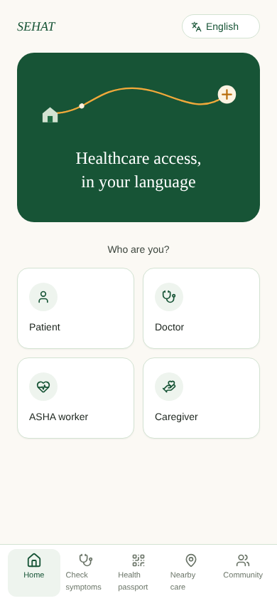
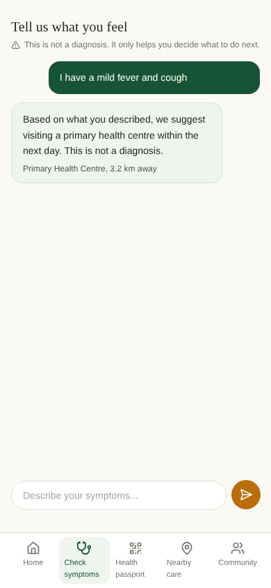

# SEHAT — Smart, Equitable Healthcare Access & Tracking

**Frontend** · Vernacular-first PWA for rural and underserved healthcare access.

Smart India Hackathon 2026 · Problem Statement SIH26133 · Theme: MedTech/Biotech/HealthTech · Team Code Crew

🔗 **Live app:** [sehat-frontend-eight.vercel.app](https://sehat-frontend-eight.vercel.app)
🔗 **Backend repo:** [Sehat-Backend](https://github.com/vikasshukla01/Sehat-Backend) · **API:** [sehat-backend-5ii6.onrender.com](https://sehat-backend-5ii6.onrender.com) ([docs](https://sehat-backend-5ii6.onrender.com/docs))

> Note: the backend runs on Render's free tier, which sleeps after 15 minutes of inactivity. The first request after a while can take 30–50 seconds to wake it up — open the API link once before a live demo to warm it up.

## Screenshots

| Home | Symptom triage |
|---|---|
|  |  |

## What it does

SEHAT connects five things that are normally disconnected for a rural patient: language, health history, nearby care, a way to get there, and a community around them.

- **Multilingual triage** — describe symptoms in any of 11 Indian languages, get non-diagnostic guidance (urgency level + what kind of facility to visit). Rule-based and explainable, not a black-box model — see [Design notes](#design-notes).
- **QR health passport** — generates a short-lived, consent-based QR token that a doctor can scan. The QR carries a token only, never raw medical records.
- **Nearby care with a real map** — your location and nearby facilities plotted on an interactive map (OpenStreetMap/Leaflet), with fastest-route / comfortable-route toggle.
- **Role-based entry points** — Patient, Doctor, ASHA worker, Caregiver each land on the flow that matters to them.
- **Community** (scaffolded) — road hazard reports, health camp alerts, verified Q&A.

## Tech stack

- **React 18 + Vite** — build tooling
- **Tailwind CSS** — styling, with a custom forest-green/marigold design system (`tailwind.config.js`)
- **react-i18next** — all 11 languages (`src/i18n/index.js`): English, Hindi, Bengali, Marathi, Telugu, Tamil, Gujarati, Kannada, Malayalam, Punjabi, Odia
- **react-leaflet + OpenStreetMap** — the Nearby Care map (free, no API key)
- **framer-motion** — page transitions and micro-interactions
- **lucide-react** — icons
- **PWA-ready** (`public/manifest.json`) — installable on a phone home screen

## Project structure

```
src/
├── api/client.js        # every backend call lives here — one place to swap mock↔real
├── i18n/index.js         # all 11 languages' translation strings
├── components/           # NavBar, LanguageSwitcher, CareMap
├── pages/                # Home, Triage, Passport, NearbyCare, Community
└── App.jsx               # routing + page transitions
```

## Connecting to the backend

`src/api/client.js` is the only file that talks to the backend. Without any configuration it runs on realistic mock data, so the whole UI works standalone. Set `VITE_API_BASE_URL` (as a Vercel project environment variable, or a local `.env`) to the backend's URL and every call automatically switches to the real API — no other code changes needed.

## Local development (optional)

Deployment doesn't need this — Vercel builds straight from GitHub. For local work:
```bash
npm install
npm run dev
```

## Deployment

Deployed on [Vercel](https://vercel.com), connected directly to this GitHub repo. Every push to `main` redeploys automatically. `vercel.json` rewrites every path to `index.html` so client-side routes (like `/triage`) work on direct navigation and refresh.

## Design notes

- **Triage is rule-based, not a black-box ML model.** It maps symptom keywords to an urgency level and always says "this is not a diagnosis" — deliberately explainable for an AI-safety conversation, and it needs no paid API key.
- **11 languages, not just English/Hindi** — every UI string and every triage response is translated, with the correct script font (Noto Sans family) loaded per language.
- **The map never fabricates your location** — it requests real browser geolocation and only falls back to a fixed demo point if permission is denied, so the demo still works offline from a judge's laptop.
